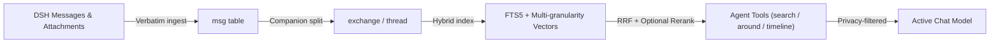

<p align="center">
  
</p>

<h1 align="center">dsh-verbatim</h1>

<p align="center">Every word kept intact · Companion-first verbatim long-term memory plugin for DeepSeek Harness.</p>

<p align="center">
  
  =24">
  
  <a href=".github/workflows/ci.yml"></a>
  <a href="LICENSE"></a>
</p>

<p align="center">
  <a href="#what-it-does">What It Does</a> ·
  <a href="#retrieval-example">Example</a> ·
  <a href="#quick-start">Quick Start</a> ·
  <a href="#how-it-works">How It Works</a> ·
  <a href="#privacy--security">Privacy &amp; Security</a> ·
  <a href="#compatibility">Compatibility</a> ·
  <a href="#uninstall">Uninstall</a> ·
  <a href="#documentation">Docs</a> ·
  <a href="#development">Development</a> ·
  <a href="README.md">简体中文</a>
</p>

> `dsh-verbatim` is a community plugin for DeepSeek Harness (also providing a CLI and stdio MCP Server) built for AI companion conversations, without modifying DeepSeek Harness source files.
>
> **Current version: 0.1.0**. Powered by Node.js `>=24` built-in `node:sqlite` and FTS5. All verbatim messages, derived indexes, and settings stay local in `$DSH_HOME/verbatim/`.

`dsh-verbatim` keeps every conversation message word for word in a local SQLite database, automatically organizes exchanges and micro-topics, and brings back full original context through hybrid keyword + vector retrieval and optional reranking even after context compaction.

## What It Does

- **Verbatim source of truth, rebuildable derived layers**: The `msg` table is append-only (rewinds/deletes physically remove the message and its vectors); past conversations remain intact after context compaction.
- **Companion-first dual granularity (`exchange` → `thread`)**: Automatically segments natural chats into single exchanges and micro-topics, with 30-minute idle scene boundaries, scene merge/split locking, and timeline cluster folding.
- **Always-hybrid retrieval + optional reranking**: Runs FTS5 trigram / 2-character CJK `LIKE` in parallel with multi-granularity vector search (`vec_msg`, `vec_chunk`, `vec_scene`, `vec_note`), fused via RRF with optional `/rerank` rescoring (and automatic fallback).
- **Image attachments & captions**: Records image attachments and resolved local paths, supports inline preview and caption editing in the sidebar panel, and returns both paths and captions to the model.
- **Strict session isolation & privacy boundaries**: Settings and data are isolated per `session_id`; user-configured private exclude time ranges and per-message "do not recall" flags are completely invisible to Agent tools and cannot be bypassed via parameters.
- **Material 3 companion UI**: Includes **6 sidebar views** (Overview, Search, Timeline, Notes, Audit, Library) and **5 global settings tabs** (3-step setup guide, local model probing, session data management, and read-only SQL diagnostics).

## Retrieval Example

When the model calls `memory_search`, it receives plain-text results with exact time spans, compact dialogue lines, and hit markers (synthetic example below):

```text
「周末去公园」— 3 处

  11-16 14:10–14:25 · 6轮 · 92字 · 命中 2 处
    我：周六天气不错，去公园散步吗？
    他：好呀，顺便去湖边坐坐 kw+vec  ←
    我：记得带上相机和防晒。 kw+vec  ←
    他："/path/to/dsh_home/attachments/v1/objects/00/0000...png" [图片]
    [图片备注：公园湖边的长椅]
```

## Quick Start

Make sure **Node.js `>=24`** is installed (uses built-in `node:sqlite`, no native C++ build toolchain required), then mount the plugin in DeepSeek Harness.

### 1. Install & Mount

```powershell
git clone https://github.com/saya-ch/dsh-verbatim.git
cd dsh-verbatim
npm install --no-audit --no-fund
```

#### Official DSH Desktop

Point to and enable the local `dsh-verbatim` directory from the **Plugins** page in DSH Desktop (the repository includes [cordis.patch.yml](cordis.patch.yml) and [package.json](package.json) manifests). Desktop profiles are managed by the app and do not use `--profile web` commands.

#### DSH Web

Mount this repository in your Web profile plugin configuration and start DSH:

```powershell
dsh --profile web
```

<details>
<summary>Using DeepSeek Harness from source or standalone CLI / MCP Server</summary>

In a DeepSeek Harness source checkout, run `pnpm dsh --profile web` with this plugin directory mounted.

You can also use the CLI or run a standard stdio MCP Server standalone:

```powershell
# CLI tool (ingest, search, stats, verify)
node bin/cli.mjs --help

# Start stdio MCP Server
node bin/mcp-memory.mjs
```

</details>

The database, global config, and per-session switches are stored under `$DSH_HOME/verbatim/` (defaults to `~/.dsh/verbatim/` if `DSH_HOME` is unset):

- `memory.db`: SQLite verbatim store and derived indexes
- `config.json`: Global embedding, rerank, and LLM settings
- `sessions/<session-id>.json`: Per-session toggles and private exclude ranges

### 2. Three Steps to Enable

1. Open **Settings → Verbatim Memory → Embedding**, choose a local service (Ollama / LM Studio auto-detection supported) or enter an OpenAI-compatible `/v1/embeddings` endpoint and test connectivity.
2. *(Optional)* Enable `/rerank` under **Rerank** to improve ranking accuracy on long histories.
3. Open the **Verbatim Memory** sidebar panel in any conversation and turn on **Remember new messages** and **Allow recall** (takes effect immediately without restarting).

## How It Works



The plugin registers the ingest pipeline, search service, and 3 read-only Agent tools (`memory_search`, `memory_around`, `memory_timeline`) on the Host side, and injects the 6-view sidebar panel and 5-tab settings page on the Client side—without modifying DeepSeek Harness core files. See [Architecture](docs/ARCHITECTURE.md) for schema and lock details.

## Privacy & Security

- **Local-first storage**: Except for the embedding (`/v1/embeddings`), rerank (`/rerank`), or optional summary LLM endpoints you configure, all memories, captions, and settings stay local in `$DSH_HOME/verbatim/`.
- **Hard privacy boundaries**: Excluded time ranges and per-message exclusions are filtered directly at the storage/retrieval layer and cannot be bypassed by Agent tool parameters.
- **Physical rewind/delete**: Rewinding or deleting messages in DSH physically removes the corresponding rows and vectors from `memory.db`.
- **Read-only SQL diagnostics**: The SQL diagnostic tab in Settings only allows read-only queries.

## Compatibility

- **Node.js**: Requires `>=24` (relies on built-in `node:sqlite`).
- **`sqlite-vec`**: Listed in `optionalDependencies`. If unavailable on the host platform, vector search automatically falls back to pure-SQLite cosine similarity with equivalent recall results.

## Uninstall

Removing `dsh-verbatim` from your DeepSeek Harness plugin configuration **does not delete** `$DSH_HOME/verbatim/`. Re-mounting the plugin restores access to your existing memories.

To remove all local data permanently, back up `memory.db` or `sessions/*.json` if needed, remove the plugin, and then delete `$DSH_HOME/verbatim/`.

## Documentation

- [Architecture](docs/ARCHITECTURE.md): Storage schema, companion dual-granularity splitting, hybrid retrieval, and write locks
- [Agent Tools & Privacy](docs/TOOLS.md): Complete schemas, output formats, and privacy isolation guarantees
- [Changelog](CHANGELOG.md): Release notes
- [Contributing](CONTRIBUTING.md): Development workflow, verification commands, and synthetic test data policy

## Development

```powershell
# Rebuild client.js from src/client/*.js
npm run build:client

# Bundle consistency, TypeScript check, and syntax checks
npm run check

# Run full unit and frontend rendering test suite
npm test
```

## License

[MIT](LICENSE)
