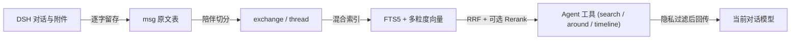

<p align="center">
  
</p>

<h1 align="center">dsh-verbatim</h1>

<p align="center">Every word kept intact · 为 DeepSeek Harness 打造的陪伴向长期逐字记忆插件。</p>

<p align="center">
  
  =24">
  
  <a href=".github/workflows/ci.yml"></a>
  <a href="LICENSE"></a>
</p>

<p align="center">
  <a href="#能做什么">能做什么</a> ·
  <a href="#检索返回示例">检索示例</a> ·
  <a href="#快速开始">快速开始</a> ·
  <a href="#工作原理">工作原理</a> ·
  <a href="#隐私与安全">隐私与安全</a> ·
  <a href="#兼容性">兼容性</a> ·
  <a href="#卸载">卸载</a> ·
  <a href="#文档导航">文档</a> ·
  <a href="#开发与验证">开发</a> ·
  <a href="README.en.md">English</a>
</p>

> `dsh-verbatim` 是面向 AI 陪伴场景的 DeepSeek Harness 社区插件（同时提供 CLI 与 MCP Server），不修改 DeepSeek Harness 源码。
>
> **当前版本：0.1.0**。基于 Node.js `>=24` 内置 `node:sqlite` 与 FTS5，所有对话原文、索引与设置均保存在本机 `$DSH_HOME/verbatim/`，无外部记忆托管服务。

`dsh-verbatim` 把每一次对话的原话一字不改地留存在本地 SQLite 中，按问答与微话题自动组织结构；当上下文被压缩或时间跨度拉长后，模型仍可通过关键词、向量语义与可选精排找回完整原话与当时语境。

## 能做什么

- **原文一字不改，派生层随时可重建**：`msg` 表作为单一事实来源只增不改（撤回消息会物理删除原文与对应向量）；即使经历多次上下文压缩，过往对话依然完整留存。
- **陪伴优先的双粒度组织（`exchange` → `thread`）**：面向日常闲聊自动切分单轮问答与微话题，配合 30 分钟静默成场、场景合并/拆分锁定与时间线聚簇折叠，召回连贯而不碎片。
- **始终混合检索 + 可选精排**：并行执行 FTS5 trigram / 2 字中文 `LIKE` 与多粒度向量检索（`vec_msg` / `vec_chunk` / `vec_scene` / `vec_note`），经 RRF 融合排序，并支持 `/rerank` 二次精排（异常自动回退）。
- **图片附件与备注回想**：入库记录对话中的图片附件与本地解析路径，支持在侧栏内联预览与编辑图片备注（`caption`），检索结果会一并把图片路径与备注交还给模型。
- **严格会话隔离与隐私边界**：开关与数据按 `session_id` 独立隔离；用户设置的「私密排除时段」与单句「暂不回想」对 Agent 工具完全不可见，杜绝任何参数绕过。
- **Material 3 陪伴向前端**：提供 **6 个侧栏视图**（概览、搜索、时间轴、笔记、核对、库）与 **5 个全局设置页**（含 3 步快速上手引导、本地模型服务探测、会话数据管理与只读 SQL 诊断）。

## 检索返回示例

模型调用 `memory_search` 时，会收到带精确时间区间、紧凑对话行与命中标记的纯文本结果（以下为虚构示例）：

```text
「周末去公园」— 3 处

  11-16 14:10–14:25 · 6轮 · 92字 · 命中 2 处
    我：周六天气不错，去公园散步吗？
    他：好呀，顺便去湖边坐坐 kw+vec  ←
    我：记得带上相机和防晒。 kw+vec  ←
    他："/path/to/dsh_home/attachments/v1/objects/00/0000...png" [图片]
    [图片备注：公园湖边的长椅]
```

## 快速开始

先确认本机已安装 **Node.js `>=24`**（使用内置 `node:sqlite`，无需额外原生编译工具），再将插件挂载到 DeepSeek Harness。

### 1. 安装与挂载

```powershell
git clone https://github.com/saya-ch/dsh-verbatim.git
cd dsh-verbatim
npm install --no-audit --no-fund
```

#### 官方 DSH Desktop

在应用的 **插件** 页面中指向并启用本地 `dsh-verbatim` 目录（仓库已包含 [cordis.patch.yml](cordis.patch.yml) 与 [package.json](package.json) 声明）。Desktop 的 profile 由应用管理，不适用下面的 `--profile web` 命令。

#### DSH Web

将本仓库挂载到 Web profile 的插件配置后启动：

```powershell
dsh --profile web
```

<details>
<summary>使用 DeepSeek Harness 源码模式或独立 CLI / MCP Server</summary>

在 DeepSeek Harness 源码目录中使用 `pnpm dsh --profile web` 启动并加载本插件目录。

如果你希望脱离插件界面单独导入、检索或作为标准 MCP Server（stdio）挂载到其他客户端：

```powershell
# CLI 工具（导入、检索、统计、校验）
node bin/cli.mjs --help

# 启动标准 MCP Server（stdio）
node bin/mcp-memory.mjs
```

</details>

记忆库、全局配置与按会话隔离的开关均保存在 `$DSH_HOME/verbatim/`（未设置 `DSH_HOME` 时默认为 `~/.dsh/verbatim/`）：

- `memory.db`：SQLite 逐字记忆库与派生索引
- `config.json`：全局模型与服务配置
- `sessions/<session-id>.json`：每个会话独立的开关与私密排除规则

### 2. 三步启用陪伴记忆

1. 打开 **设置 → 逐字记忆 → 向量模型**，选择本地服务（支持 Ollama / LM Studio 自动扫描）或填写兼容 OpenAI `/v1/embeddings` 的远程接口并测试连通性。
2. （可选）在 **精排模型** 中开启 `/rerank` 精排，提升长记忆场景下的排序准确度。
3. 打开任意对话右侧栏的 **逐字记忆** 面板，开启 **记住新对话** 与 **让 TA 随时回想**（热更新立即生效，无需重启）。

## 工作原理



插件通过 Host 服务挂载入库管线、检索服务与 3 个 Agent 只读工具（`memory_search`、`memory_around`、`memory_timeline`），并通过 Client 入口注入侧栏 6 视图与设置页 5 个标签页；不改写 DeepSeek Harness 安装目录中的源码。详细表结构与写入锁设计见 [系统架构说明](docs/ARCHITECTURE.md)。

## 隐私与安全

- **数据不出本机**：除你主动配置的向量 `/v1/embeddings` 与精排 `/rerank` 模型接口外，记忆库、附件备注与配置全部留在本地 `$DSH_HOME/verbatim/`。
- **硬隐私边界**：用户在面板中设置的「私密排除时段」与单句「暂不回想」在检索与工具查询层直接过滤，对 Agent 完全不可见，无法通过工具参数绕过。
- **物理撤回**：用户在 DSH 中撤回或删除消息时，对应原文与向量索引会从本地库中物理移除。
- **只读诊断**：设置页提供的 SQL 诊断入口仅允许执行只读查询，不会修改记忆原文。

## 兼容性

- **Node.js**：要求 `>=24`（依赖内置 `node:sqlite`）。
- **`sqlite-vec`**：作为 `optionalDependencies` 安装；若当前平台未加载成功，系统会自动降级为纯 SQLite 余弦检索，功能与召回结果等价，仅在大库全量扫描时略慢。

## 卸载

仅从 DeepSeek Harness 插件配置中移除 `dsh-verbatim` **不会删除** `$DSH_HOME/verbatim/` 中的记忆库与配置，重新挂载即可继续使用。

如需彻底清理本机数据，请先备份需要的 `memory.db` 或 `sessions/*.json`，移除插件后再手动删除 `$DSH_HOME/verbatim/` 目录。

## 文档导航

- [系统架构说明](docs/ARCHITECTURE.md)：存储表结构、陪伴双粒度切分、混合检索与写入锁设计
- [Agent 工具与隐私边界](docs/TOOLS.md)：3 个工具的完整 Schema、返回格式与隐私隔离机制
- [更新日志](CHANGELOG.md)：版本变更记录
- [贡献指南](CONTRIBUTING.md)：本地开发、校验流程与脱敏测试规范

## 开发与验证

```powershell
# 从 src/client/*.js 重新打包前端产物 client.js
npm run build:client

# 一致性检查、TypeScript 类型检查与语法校验
npm run check

# 运行完整单元测试与前端渲染测试
npm test
```

## License

[MIT](LICENSE)
